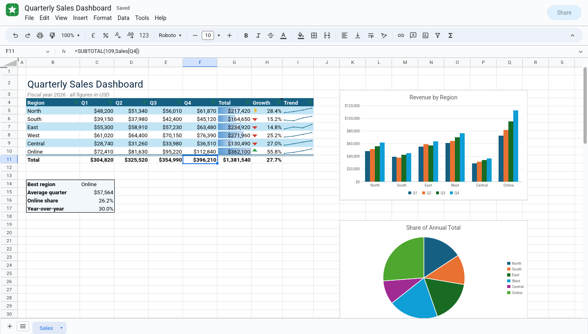

# StarSheets

A spreadsheet that looks and feels like Google Sheets, that you can run yourself.



I wanted the spreadsheet I'm used to (Google Sheets' menus, shortcuts and side panels) without my
files living in someone else's cloud. StarSheets is my attempt at that: it runs in your browser,
your spreadsheets are ordinary `.xlsx` files in a folder you choose, and it's free and open source.

It stands on the shoulders of [GridCraft](https://github.com/storytold/gridcraft), a fast
spreadsheet engine written in Rust by the ArtCraft team. GridCraft does the hard parts
(formulas, files, the grid, charts); StarSheets puts a Google Sheets-style face on it and adds
the things Google Sheets users reach for.

> **Status: early preview.** It's usable and I use it myself, but there are rough edges and
> missing pieces. Please don't trust it with anything you can't afford to lose yet, and do
> [tell me what breaks](../../issues/new/choose).

## What you get

- **Google Sheets' layout and habits**: menu bar, one-row toolbar, side panels, right-click menus,
  sheet tabs, Google's sizes, fonts and keyboard shortcuts.
- **Conditional formatting and data validation** in Google-style side panels, previewed live as
  you choose. Drop-down lists with coloured items, date pickers, colour scales.
- **Google Sheets formulas** on top of GridCraft's hundreds of Excel-compatible ones: `QUERY`,
  `ARRAYFORMULA` and `{…}` arrays.
- **Files without a Save button**: every change saves itself a moment later, into plain `.xlsx`
  files. A file window with folders, copy and paste, drag and drop, a bin and version history.
- **Excel files open well**, because GridCraft was built to match Excel.

What's not here (yet): working on one sheet together with others in real time, sharing links,
comments with mentions, add-ons, and desktop apps. See the [roadmap](ROADMAP.md).

## Try it with Docker

```sh
docker run -d --name starsheets --restart unless-stopped -p 8080:8080 -v starsheets:/data ghcr.io/domeshifter/starsheets:latest
docker logs starsheets   # shows the setup code
```

Then open <http://localhost:8080> and make your account with the setup code from the log: you
become the server's owner and can add other people (your avatar › People), or turn on sign-up so
they can make their own account, with a code you give out if you like. Everyone signs in with
a username and password kept on your server; there is no sign-in through other companies. Your
spreadsheets are kept as `.xlsx` files in the `starsheets` volume. There's a ready-made
[compose file](docker/compose.yml) too.

- Open the same spreadsheet in several tabs, or with other people, and everyone sees every change
  as it happens, with each other's cursors.
- On a private network you trust, `STARSHEETS_AUTH=off` turns sign-in off (everyone is a guest).
- Copy and paste work best over HTTPS (browsers limit the clipboard on plain `http://`), so a
  reverse proxy with a certificate is a good idea if you use it from other machines.

## Build it yourself

You need Rust (stable) with the `wasm32-unknown-unknown` target, [trunk](https://trunkrs.dev) and
Python 3.

```sh
scripts/fetch-upstream.sh          # GridCraft at the pinned release, with StarSheets' patches
python3 scripts/fetch-fonts.py     # the free fonts in the font menu
cd app && trunk build --release    # the app, in dist/
```

Serve `dist/` with any web server, or run the server (`cargo run --release -p starsheets-server`)
with `SITE=app/dist` to get the app and the file storage together. More in [docs/deploy.md](docs/deploy.md) and
[CONTRIBUTING.md](CONTRIBUTING.md).

## How it fits together

| Part | Where it comes from |
|---|---|
| Formula engine, xlsx/csv import and export, grid, charts | [GridCraft](https://github.com/storytold/gridcraft), pinned to one release, with small patches (`patches/`, listed in [docs/upstream.md](docs/upstream.md)) |
| Google Sheets look: title, menus, toolbar, side panels | `app/` |
| Google-only functions (QUERY) | `crates/sheets-functions` |
| File storage, login (and soon live editing) | `crates/server` (Rust) |

Design choices and the reasons for them are in [docs/decisions.md](docs/decisions.md).

## Thanks

To the ArtCraft team for GridCraft, to the [egui](https://github.com/emilk/egui) project, and to
the designers of the fonts StarSheets uses (Roboto and the Google Fonts families listed in each
build's `webfonts/NOTICE.txt`, all under the SIL Open Font License) and of Google's Material Symbols icons.

## Licence

MIT or Apache-2.0, at your option ([LICENSE-MIT](LICENSE-MIT), [LICENSE-APACHE](LICENSE-APACHE),
[NOTICE](NOTICE)).

StarSheets is not affiliated with or endorsed by Google or the ArtCraft team. "Google Sheets" is a
trademark of Google LLC, mentioned only to describe the look StarSheets aims for.
